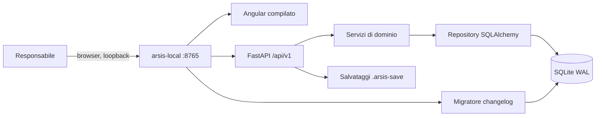

# Arsis — Architettura

_Aggiornato: 8 novembre 2026_

Come è costruita Arsis e perché. I requisiti di prodotto sono in
[Specifica funzionale](SPECIFICA_FUNZIONALE.md); cosa è già implementato è in
[Stato](STATO.md).

Questo documento sostituisce la specifica tecnica v0.3 e gli ADR 0001–0004:
le loro decisioni ancora valide sono riportate nella sezione 2.

## 1. Panoramica

Arsis è un **monolite modulare installato sul PC dell'associazione**: un solo
processo FastAPI serve l'API `/api/v1` e la SPA Angular compilata, legge e scrive
un database SQLite locale e ascolta solo su `127.0.0.1`.



- Angular gestisce presentazione, navigazione e validazioni immediate.
- FastAPI applica autenticazione, validazioni definitive e regole di business.
- SQLite garantisce persistenza, vincoli e transazioni; solo il backend apre il file.
- L'API è l'unico canale fra frontend e dati.

Non sono previsti microservizi, code, real-time né funzionamento multi-istanza.

## 2. Decisioni

| Tema | Decisione | Origine |
|---|---|---|
| Stack | Python 3.14, FastAPI 0.140, SQLAlchemy 2.0 sincrono (`<2.1`), Pydantic 2; Angular 22 standalone, TypeScript strict, Node.js 24 | ADR 0001 |
| Database | SQLite al posto di PostgreSQL; niente Docker né servizio database | ADR 0002 |
| Distribuzione | Eseguibile Windows on-premise, Angular servito dal backend, un solo worker | ADR 0002 |
| Migrazioni | Changelog Liquibase come fonte autorevole dello schema; in produzione lo applica `arsis.core.migrations`, senza Java | 7a |
| JSON | `snake_case`, ID interi, timestamp ISO 8601 | ADR 0003 |
| Autenticazione | Argon2id, access token JWT breve in memoria, refresh token ruotato in cookie HttpOnly | ADR 0004 |
| Primo accesso | Il primo responsabile si crea dalla pagina di accesso su un database vuoto | 7a |
| Salvataggi | Export/import `.arsis-save` dall'interfaccia, in modalità manutenzione | 7b-1 |

Quando cambiare: un ritorno a PostgreSQL (con migrazione dei dati) andrà
valutato se crescono scritture simultanee, istanze o requisiti di disponibilità.
Per una pubblicazione in rete servono HTTPS, reverse proxy, CORS ristretto e
backup lato server. API e servizi restano indipendenti dal tipo di database.

## 3. Backend

### 3.1 Organizzazione

```text
backend/src/arsis/
├── main.py              # create_app(): middleware, router, SPA
├── local_runtime.py     # arsis-local: avvio, singola istanza, migrazioni
├── migrate.py           # arsis-migrate
├── core/                # config, database, errori, sicurezza, migrazioni,
│                        # backup, salvataggi, manutenzione, request ID, log
├── generated/           # modelli SQLAlchemy e DTO generati dallo schema (non modificare)
├── auth/  people/  catalogues/  activities/  school/
├── accounting/  dashboard/  settings/  maintenance/  audit/
└── dev/                 # seed dimostrativo
```

Ogni modulo funzionale contiene, quando serve, `router.py` (HTTP), `schemas.py`
(DTO pubblici), `service.py` (casi d'uso e transazioni) e `repository.py` (query).

Regole:

- i router chiamano i servizi, non i repository;
- i servizi delimitano le transazioni con `transaction(session)`, che rifiuta una
  transazione già aperta; caricano i propri record dentro la transazione;
- i repository non contengono decisioni di dominio;
- i DTO pubblici derivano da `ApiModel` e restano distinti dai modelli generati;
- stack interamente sincrono: il carico non giustifica l'asincrono.

### 3.2 Configurazione

`Settings` (`core/config.py`) legge l'ambiente e il file `.env` della radice
(modello in `.env.example`, senza segreti). Variabili principali: `APP_ENV`,
`APP_SECRET_KEY`, `ARSIS_DATA_DIR`, `SERVE_FRONTEND`, `LOCAL_BIND_HOST`,
`LOCAL_BIND_PORT`, `ALLOWED_ORIGINS`, `ACCESS_TOKEN_TTL`, `REFRESH_TOKEN_TTL`,
`LOG_LEVEL`. In staging e produzione una chiave d'esempio blocca l'avvio; il
runtime locale la sostituisce con `secret.key` generata per installazione.

### 3.3 Cartella dati

Tutto ciò che appartiene all'utente sta in `ARSIS_DATA_DIR`, predefinita `data/`
nel repository e `%LOCALAPPDATA%\Arsis` nell'exe; mai accanto al binario.

| Percorso | Contenuto |
|---|---|
| `arsis.db` | database SQLite |
| `attachments/` | allegati (oggi vuota) |
| `backups/` | `pre-migrazione-*.db` e `pre-import-*.arsis-save` |
| `secret.key` | chiave di firma dei token |
| `logs/arsis.log` | output dell'exe senza console |
| `tmp/` | file temporanei di export e import |

Regole per le nuove funzioni: ogni dato persistente va nel database o in questa
cartella; gli allegati usano percorsi relativi; ogni nuova area con file va inclusa
nei salvataggi `.arsis-save`. Il database non va su OneDrive, NAS o share di rete.

## 4. Database

### 4.1 Convenzioni

- SQLite con `foreign_keys=ON`, journal WAL, `busy_timeout` e transazioni brevi.
- Chiavi primarie `INTEGER PRIMARY KEY`; nomi in `snake_case`.
- Timestamp tecnici in UTC ISO 8601 (`…Z`). Gli orari di dominio (`starts_at`
  di attività e lezioni) conservano l'ora locale con il fuso
  (`2026-11-08T20:45:00+01:00`): i primi dieci caratteri sono la data locale.
- Date di dominio `YYYY-MM-DD`.
- Importi `NUMERIC`, mai floating point: i modelli li leggono come
  `Numeric(scale=2)` e l'API li restituisce come stringa (`"180.50"`, tipo `Money`).
- Stati come stringhe con vincoli `CHECK`.
- Foreign key `RESTRICT`/`NO ACTION`; nessuna cascata sulle entità di dominio.

Colonne comuni delle tabelle principali: `created_at`, `created_by`,
`updated_at`, `updated_by`, `archived_at`, `archived_by`, `version`.

### 4.2 Archiviazione e concorrenza

- Le entità di dominio si **archiviano** (`archived_at`), non si cancellano; le
  viste operative le escludono, lo storico le conserva. Fanno eccezione i
  movimenti contabili, cancellabili e tracciati nell'audit.
- Le modifiche inviano la `version` letta; l'update verifica atomicamente ID e
  versione. Versione superata: `409 STALE_VERSION`; ID assente: `404`.
- Le scritture registrano l'audit nella stessa transazione.

### 4.3 Schema

Le tabelle sono definite in `database/changelog/changes/0001…0008-*.sql`.
Regole di dominio che lo schema o i servizi garantiscono:

| Area | Tabelle | Regole |
|---|---|---|
| Sicurezza | `users`, `refresh_sessions` | email univoca senza distinzione di maiuscole; refresh token solo come hash SHA-256 |
| Anagrafica | `people`, `person_roles`, `members`, `musicians`, `students`, `teachers`, `associated_contacts` | un ruolo attivo per tipo e persona; contatto associato diverso dalla persona e senza duplicati attivi |
| Cataloghi | `sections`, `instruments`, `musician_instruments` | nomi univoci fra gli attivi; ogni strumento ha una sezione; le sezioni del musicante derivano dagli strumenti; al massimo uno strumento principale |
| Attività | `activities`, `activity_participants` | coppia attività–persona univoca; i convocati sono materializzati e non cambiano se cambia il ruolo |
| Scuola | `courses`, `course_installment_templates`, `enrollments`, `enrollment_discounts`, `lessons`, `lesson_attendances` | insegnante con ruolo attivo; `annual_fee >= 0`; nessuna iscrizione attiva duplicata; giorno e orario del corso non generano lezioni |
| Contabilità | `accounting_categories`, `accounting_movements`, `accounting_opening_balances` | importo positivo; verso ammesso dalla categoria; un saldo iniziale per esercizio e conto |
| Sistema | `app_settings`, `audit_events` | nessun segreto nelle impostazioni; audit senza password, token o copie di dati personali |

Convocazione: alla creazione di un'attività vengono inseriti (`source = automatic`)
i musicanti attivi alla data; chi è rimosso viene archiviato e non torna con una
nuova convocazione, ma può essere riaggiunto a mano. Le presenze (`present`,
`absent` o vuoto = non registrata) valgono solo per partecipanti non archiviati.

Registro lezioni: propone gli allievi con iscrizione valida alla data della
lezione; le righe salvate restano storiche.

Movimenti contabili: il servizio verifica categoria attiva e verso; se la
categoria richiede un ruolo, persona con quel ruolo alla data; se richiede un
corso, corso non archiviato; per un allievo l'iscrizione al corso, per un
insegnante l'assegnazione al corso. Cambiare solo `is_highlighted` non ripete le
verifiche. Il saldo finale non è memorizzato: saldo iniziale + entrate − uscite.

### 4.4 Migrazioni e codice generato

- Il changelog (`database/changelog/db.changelog-master.yaml` + formatted SQL in
  `changes/`) è l'unica fonte dello schema. FastAPI non usa `create_all()`.
- Ogni changeset ha ID stabile, autore, una sola responsabilità; quelli già
  applicati non si modificano, le correzioni sono nuovi changeset.
- **Sviluppo:** `scripts/init-db.ps1` applica il changelog con Liquibase (Java 17+)
  e rigenera `arsis/generated/` con `scripts/generate_backend_schema.py`.
- **Runtime:** `arsis.core.migrations` legge lo stesso changelog e scrive nella
  stessa `DATABASECHANGELOG` (checksum vuoto, completato da Liquibase al primo
  passaggio). Prima di migrare copia il database in `backups/`; ogni changeset ha
  una transazione propria; un database con changeset sconosciuti (versione più
  recente) viene rifiutato.
- **Coerenza:** i modelli generati contengono `SCHEMA_FINGERPRINT`;
  `generate_backend_schema.py --check` e `database/tests/verify_schema.py` girano
  in CI su un database creato da `arsis-migrate`.

## 5. Contratto API

### 5.1 Convenzioni

- Prefisso `/api/v1`; documentazione OpenAPI su `/docs`; operation ID
  `{tag}_{funzione}`.
- Liste: `page` (da 1), `page_size` (25, massimo 100), `sort=campo` o
  `sort=-campo` su campi dichiarati; risposta `{"items": [...], "meta": {"page",
  "page_size", "total_items", "total_pages"}}`.
- Ogni risposta ha `X-Request-ID` (quello del client se valido, altrimenti un
  UUID), presente anche nei log e nell'audit.

Errori, sempre nella stessa forma:

```json
{
  "error": {
    "code": "RESOURCE_NOT_FOUND",
    "message": "Risorsa non trovata: Persona",
    "details": {},
    "request_id": "7d248d4f-5c50-43ff-ac23-7dc3d0909856"
  }
}
```

`message` è presentabile all'utente; `code` serve al frontend per i casi noti.
Gli errori inattesi rispondono con un messaggio generico, i dettagli restano nei
log. Codici: `401` non autenticato, `404` assente, `409` conflitto di dominio o
versione, `422` validazione, `429` troppi tentativi, `503` manutenzione in corso.

### 5.2 Endpoint

Tutti richiedono un responsabile autenticato, tranne health, login, refresh,
logout e setup. "Archivia" è un `DELETE` che imposta `archived_at`.

| Area | Endpoint |
|---|---|
| Health | `GET /health/live`, `GET /health/ready` |
| Auth | `POST /auth/login`, `POST /auth/refresh`, `POST /auth/logout`, `GET /auth/me`, `GET`/`POST /auth/setup` |
| Persone | `GET`/`POST /people`, `GET`/`PATCH`/`DELETE /people/{id}`, `GET`/`POST /people/{id}/roles`, `PATCH`/`DELETE /people/roles/{role_id}` |
| Cataloghi | `GET`/`POST /sections`, `PATCH`/`DELETE /sections/{id}`; idem `/instruments` |
| Attività | `GET`/`POST /activities` (`q`, `starts_from`, `starts_to`), `GET`/`PATCH`/`DELETE /activities/{id}`, `GET`/`POST /activities/{id}/participants`, `DELETE /activities/{id}/participants/{person_id}`, `POST /activities/{id}/participants/musicians`, `PUT /activities/{id}/attendances`, `GET /activities/participations?person_id=` |
| Corsi | `GET`/`POST /courses`, `GET`/`PATCH`/`DELETE /courses/{id}` |
| Iscrizioni | `GET`/`POST /enrollments`, `GET`/`PATCH`/`DELETE /enrollments/{id}` |
| Lezioni | `GET`/`POST /lessons`, `GET`/`PATCH`/`DELETE /lessons/{id}`, `GET`/`PUT /lessons/{id}/attendances`, `GET /lessons/{id}/attendances/template`, `POST /lessons/{id}/attendances/import` |
| Contabilità | `GET`/`POST /accounting/categories`, `PATCH`/`DELETE /accounting/categories/{id}`; `GET`/`POST /accounting/movements` (anno, mese, conto, verso, categoria, persona, corso, `q`, `is_highlighted`), `PATCH`/`DELETE /accounting/movements/{id}`; `GET`/`PUT /accounting/opening-balances/{year}`; `GET /accounting/summary/{year}` |
| Dashboard | `GET /dashboard/summary?on=` |
| Configurazioni | `GET`/`PUT /settings/general`, `GET`/`POST /settings/responsible-users`, `PATCH /settings/responsible-users/{id}` |
| Salvataggi | `GET /maintenance/saves/export`, `POST /maintenance/saves/inspect`, `POST /maintenance/saves/import` |

Note:

- Le attività restituiscono `participant_count`, `present_count`, `absent_count`.
  `participants/musicians` aggiunge i musicanti attivi non ancora presenti, senza
  riaggiungere i rimossi a mano. Il filtro per date lavora sulla data locale.
- `dashboard/summary` alimenta Home e panoramica della Scuola: persone attive per
  ruolo, sezioni, corsi, iscrizioni, lezioni e presenze del mese, prossime
  cinque attività, lezioni del giorno, allievi per corso. Nessun dato contabile.
- `accounting/summary` dà per Banca e Cassa saldo iniziale, entrate, uscite e
  saldo finale, più i totali per categoria. Codici dedicati:
  `ACCOUNTING_CATEGORY_EXISTS`, `INVALID_ACCOUNTING_*`, `ACCOUNTING_COURSE_REQUIRED`.
- L'URL dell'archivio Google Drive è un'impostazione generale: il frontend lo
  apre direttamente, il backend non fa da proxy. La palette dei corsi è un dato
  del frontend (`core/config/course-colors.ts`).
- Il salvataggio delle presenze sostituisce in modo deterministico il registro:
  un retry non crea duplicati e l'import Excel è ripetibile.

## 6. Sicurezza

- **Password:** hash Argon2id (`pwdlib`), almeno 12 caratteri, mai nei log.
- **Sessione:** il login restituisce un access token JWT HS256 (15 minuti),
  tenuto solo in memoria dal frontend e inviato come Bearer. Il refresh token è
  opaco, in cookie `HttpOnly`, `SameSite=Lax` (anche `Secure` in staging e
  produzione), ruotato a ogni refresh e salvato solo come hash. Il logout revoca
  la sessione.
- **Utente:** ogni richiesta rilegge l'utente, quindi disattivazione e
  archiviazione hanno effetto subito. Un solo ruolo, `responsible`, verificato in
  modo centralizzato (`CurrentUser`).
- **Primo avvio:** `POST /auth/setup` crea il primo responsabile solo se non
  esistono utenti; `arsis-bootstrap-admin` fa lo stesso da riga di comando.
- **Accessi falliti:** al massimo 5 per indirizzo e account e 20 per indirizzo in
  15 minuti, poi `429` con `Retry-After` (in memoria).
- **Chiave di firma:** `secret.key` generata per installazione.
- **Import di un salvataggio:** richiede la password e revoca i token emessi
  prima dell'import.
- **Rete:** binding solo loopback; CORS limitato a `ALLOWED_ORIGINS` (serve solo
  in sviluppo).
- **Dati personali:** raccogliere solo i dati previsti, niente dati personali
  nei log, dati sintetici in sviluppo (`arsis-seed`), salvataggi da custodire.

## 7. Frontend

### 7.1 Scelte

- Componenti standalone, `OnPush`, signals per lo stato locale, RxJS per le
  richieste; nessuno store globale.
- Router con lazy loading per area; guard di autenticazione.
- Moduli template-driven con `ngModel`; il backend resta la fonte autorevole
  delle validazioni.
- Servizi per feature che parlano con l'API; tipi TypeScript scritti a mano
  accanto al servizio.
- `authInterceptor`: aggiunge il Bearer, al `401` tenta un refresh e ripete la
  richiesta, altrimenti chiude la sessione. `apiErrorMessage()` mostra il
  `message` dell'API.
- Date locali con `core/time/local-datetime.ts` (`toOffsetIso`, `localDateKey`).
- Filtri importanti nei query parameter (ruolo, tipo, scheda contabile).

### 7.2 Struttura e routing

```text
frontend/src/
├── styles/            # tokens.css, global.css
└── app/
    ├── app.routes.ts
    ├── core/          # api, auth, config, health, layout (shell, navigation.ts), time
    ├── shared/ui/     # page header, card di dettaglio, filtri
    └── features/      # home, people, activities, school, archive, accounting, settings, auth
```

| Route | Pagina |
|---|---|
| `/login` | accesso o creazione del primo responsabile |
| `/home` | dashboard |
| `/people`, `/people/new`, `/people/:id` | anagrafica (`?role=` per i filtri) |
| `/activities`, `/activities/calendar`, `/activities/new`, `/activities/:id`, `/activities/:id/attendance` | attività (`?type=`) |
| `/school/courses`, `/school/enrollments`, `/school/lessons` (+ `/new`, `/:id`), `/school/lessons/:id/attendance` | scuola |
| `/archive` | collegamento Google Drive |
| `/accounting?tab=register\|balance` | prima nota e bilancio |
| `/settings`, `/settings/catalogues`, `/settings/accounting-categories`, `/settings/saves` | configurazioni |

La shell ha topbar con le sei aree e sidebar dell'area attiva (`navigation.ts`).
Configurazioni ha una sidebar ma nessuna voce nella topbar: si apre dal menu
utente.

### 7.3 Design system

- `src/styles/tokens.css` deriva da [Design tokens v1.1](riferimenti/design-tokens.md):
  nessun colore di brand nei componenti, solo token semantici.
- Tema chiaro predefinito, override `[data-theme="dark"]`.
- Spaziatura su griglia 4 px; raggi e ombre solo da token.
- Colori dei corsi e degli avatar sono dati applicativi, non token di tema.
- Accessibilità: label esplicite, focus visibile, stati non affidati al solo
  colore, `prefers-reduced-motion` rispettato.

## 8. Runtime locale e manutenzione

`arsis-local` (exe: `Arsis.exe`) all'avvio:

1. usa o crea `secret.key` se la chiave configurata è quella d'esempio;
2. se sulla porta risponde già Arsis apre solo il browser; se la porta è di un
   altro programma mostra un errore;
3. applica le migrazioni mancanti, con backup;
4. serve API e SPA su `127.0.0.1:8765` e apre il browser.

Gli errori bloccanti compaiono in una finestra nell'exe, su stderr altrimenti.

**Modalità manutenzione** (`core/maintenance.py`): un middleware conta le
richieste `/api/`. L'import di un salvataggio attende la fine delle altre (30 s,
poi `409 MAINTENANCE_BUSY`), risponde `503 MAINTENANCE_IN_PROGRESS` a quelle nuove,
chiude le connessioni, sostituisce il file e lascia che il motore si ricrei alla
richiesta successiva. Dettagli in [Salvataggi](operations/salvataggi.md).

## 9. Log, audit e health

- Log su stdout (file `logs/arsis.log` nell'exe) con request ID; stack trace solo
  nei log; niente password né token.
- `GET /health/live`: processo avviato. `GET /health/ready`: database
  raggiungibile. La shell mostra lo stato del database.
- Audit (`audit_events`, `arsis.audit.service`) nella stessa transazione per:
  persone e ruoli, partecipanti e presenze, corsi, iscrizioni, lezioni, cataloghi,
  configurazioni, responsabili, movimenti e categorie contabili.

## 10. Test e CI

- **Backend:** `pytest` con test unitari (servizi, migratore, salvataggi,
  launcher) e di API (database SQLite temporaneo). Ruff e mypy strict.
- **CI** (`.github/workflows/ci.yml`, su ogni PR): Ruff, mypy, pytest; database
  creato da `arsis-migrate`, confrontato con i modelli generati e con
  `verify_schema.py`; `npm ci` e build Angular.
- Mancano test frontend ed end-to-end: vedi [TODO](TODO.md).

Flussi end-to-end da coprire: accesso e primo avvio; persona con più ruoli;
contatto associato; strumenti e sezioni; attività con convocati e presenze;
corso, iscrizione e agevolazione; lezione e registro presenze; prima nota e
bilancio; archiviazione senza perdita dello storico; archivio Drive; export e
import di un salvataggio.

## 11. Fuori perimetro tecnico

Microservizi, code e broker, event sourcing, GraphQL, WebSocket, app mobile
nativa, offline, integrazione API con Google Drive, multi-tenancy, generazione
automatica di rate, crediti e compensi.
